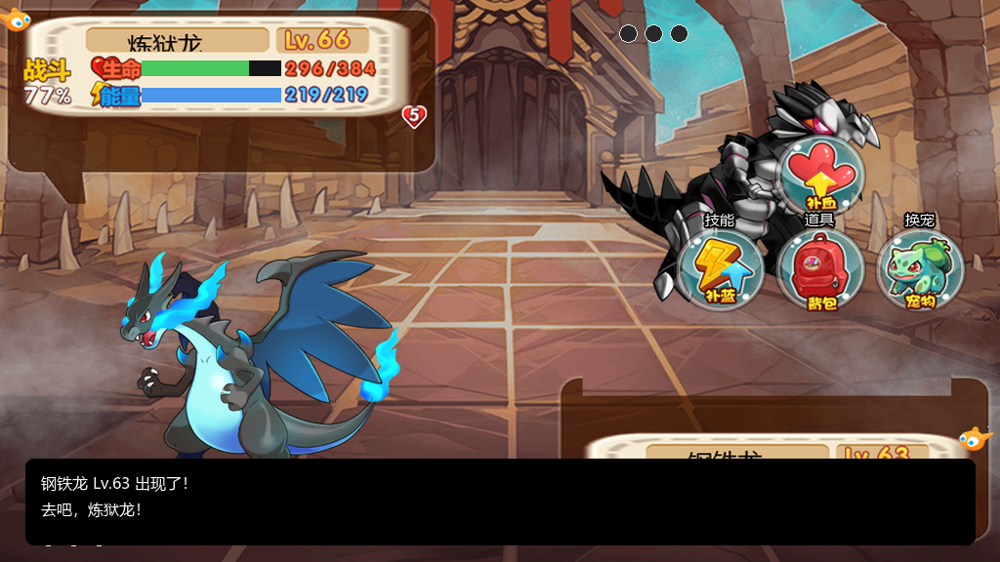
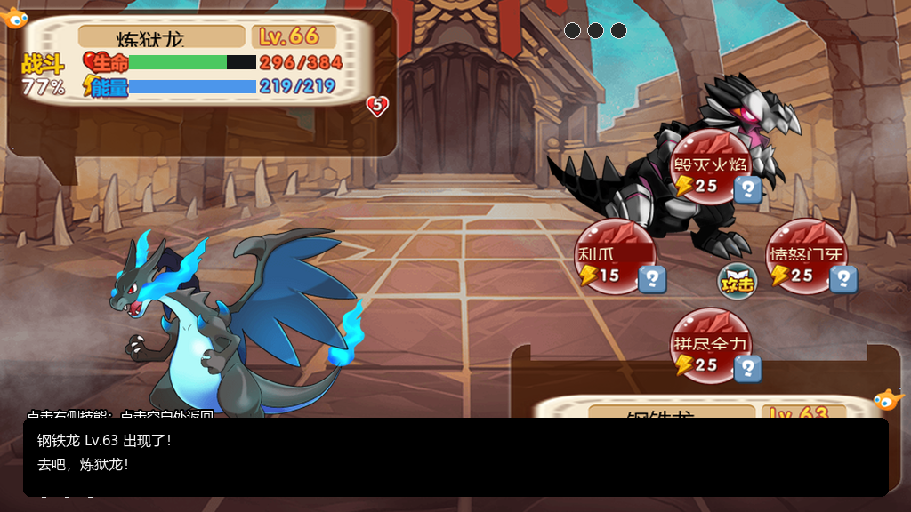
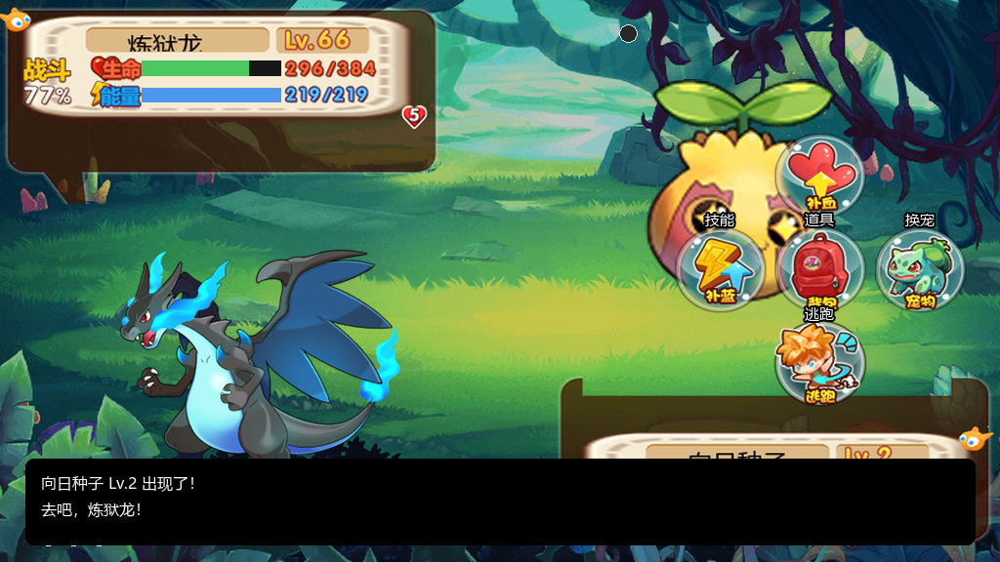
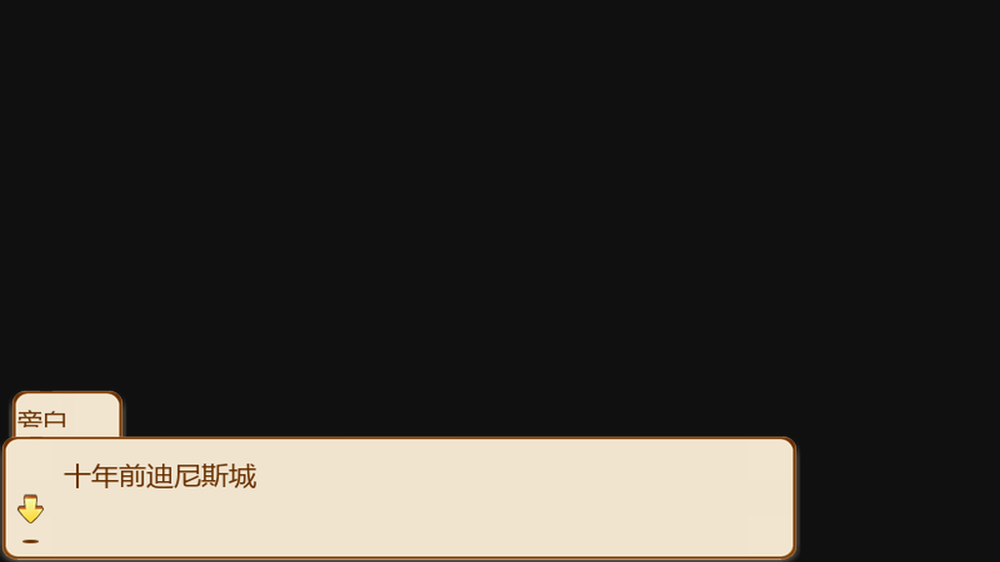
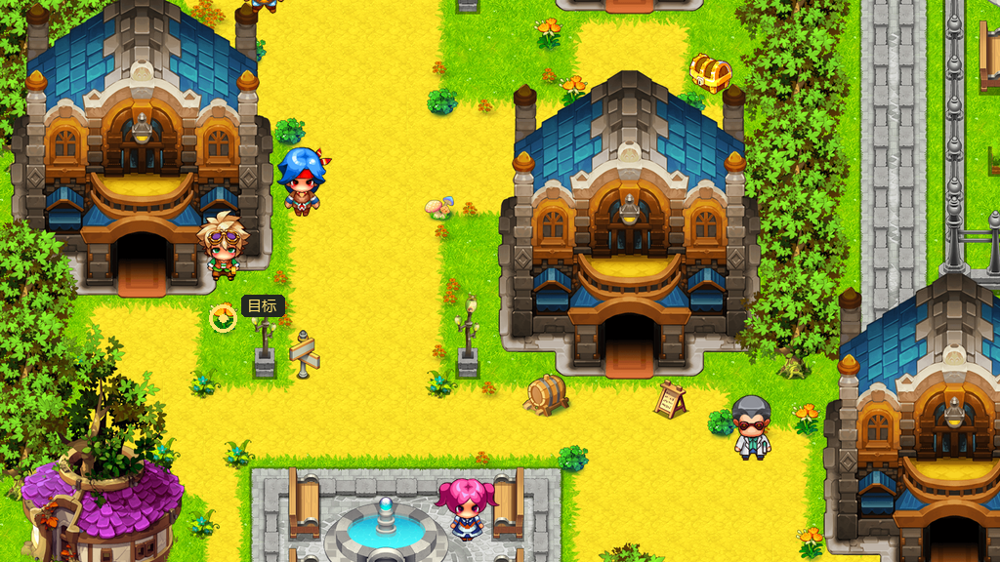

# 口袋妖怪单机版 · 原生 Windows PC 移植

[](#当前完成度)
[](#从源码运行)
[](https://www.python.org/)

使用《口袋妖怪单机版》1.20.4 原版数据、地图、Cocos UI 与 Spine 资源制作的**原生 Windows 桌面移植**。不是安卓模拟器封装，不依赖网页或网络服务。

> **当前是 0.2.35 开发版，不是完整 1∶1 成品。** 序章、初始宠物、战斗与捕捉、主线 1–6 有受控测试；不代表全程步行通关。大量系统和页面、原版动画及转场仍未完成。遇到未实现的机制会明确停下，不伪造通过。

### 当前开发改动

新增抽宠、幸运轮盘、卡牌、孵化、银行存取、宠物商店、技能学习及卷轴、训练、突破、原版宠物合体与融合的交互；
修复战斗换宠与 NPC 用药、奖励重复领取、扣费失败留下部分修改、主线任务 6 捕捉后卡住等问题。
护士治疗与普通地图宝箱也已接入。0.2.2 修复战斗按钮完整节点名未分发的故障；
按原 ARM 回调恢复“点我方打开补给/换宠，点敌方打开技能”的入口，补蓝/补血各筛选对应道具，
保留原图标与菜单坐标，技能/道具说明可点击。取消遮挡敌方血条的自制日志框；静态战斗帧复用以减少无效重绘。
坐骑现在按原表区分地形通行、地图禁用、自动换乘和手动飞行；基础移动速度 320，坐骑按 speed/100 缩放。
任务指引已接入原版任务条件解析、跨地图出口路线和逐格实际移动，修正出口落点在地图外或墙内的旧问题。
原版 Cocos 按钮现在全部建立真实点击区域，按下时优先切换原版 pressed 纹理；`closeui` 的 no/yes 分支
会按玩家的实际确认结果跳转。合体（PetHeTi）与融合（PetMerge）已按 ARM 反汇编接入材料、货币、
属性平均值/加成、品质重算和原子回滚；竞技场已接入原版事件 `openui 10 → closeui yes → fight type=3`
往返、真实 ArenaNpcPet 队伍、排名/称号/连胜/徽章与 Boss 掉落；无限竞技场已接入
`openui 19/20 → closeui yes → fight type=5`、五层 IArenaNpc 队伍、徽章消耗、荣誉/层数推进和商店。
0.2.6 接入原版藏宝图购买、放大镜显现、随机 `TChestPos` 地图宝箱、`TChest` 开箱与开箱光效，
并补齐内部 UI 37/38；战斗事件现在有突进、受击闪烁、伤害飘字和血条缓动。
0.2.7 接入原版赛宠嘉年华：`RunningPet` 数据随机四只赛宠、`Formula_GetRunningPetWinProbability`
原公式、`RunningPetReadyUILayer::handleResult` 原倍率结算、10–9999 奖牌押注与左右循环、
8 秒冠军时间轴、四只 `zq` 原始骨架、结果页与 `MedalShop` 801（1 徽章换 100 奖牌）。
同版本接入原版连续登录 7 天奖励表、同日防重复、断签重置和原奖励原子发放。
0.2.8 接入原版道馆试练：`openui 15 par1=<道馆>` → `closeui yes` → `fight type=4 npcid=<道馆>`
往返，按 `Budokan` / `BudokanNpc` / `BudokanNpcPet` 顺序生成二十场真实战斗；
胜利推进 `GameState.budokans`，失败不推进，第二十场按原表发放该道馆高级进化材料。
0.2.9 接入原版每日任务 `DailyTask` 八行（七项日常 + 全能训练），按原条件接入捕捉、NPC 战斗、
聊天、购买、轮盘、卡牌获胜、赛宠获胜计数；每天重置，完成与领取分离，奖励原子发放。
TaskUI 的每日页可用真实按钮领取；原版任务页的逐帧 item 动画和服务器时间校准仍未完成。
0.2.10 接入原版 `obsType` 树/岩障碍：护城龙破坏岩石、陆行鸟砍伐树木，月桂叶穿越荆棘、
炼狱龙越过全部障碍、乘龙渡水；障碍从 `spriteTileLayer` 真实移除、写入
`removed_obstacles` 并推进 `conditionType=6` 任务，试乘 `wait type=3` 在破障后继续。
当前 143 张地图共解析 10,937 个原版障碍对象。
0.2.11 接通 TaskUI 三页与 `tag_task_main/branch/daily` 原标签：主线和已接支线显示真实
`MainTask`/`BranchTask` 名称、描述、状态、条件进度与奖励；每日页保留八行领取。
主线/支线奖励仍由原目标 NPC 的 `submittask` 事件发放，界面不会伪造远程领奖。
破障时加入按障碍类型着色的碎片与尘土短动画；这是表现层，碰撞和任务写入已先完成。
0.2.12 接入原版 `AcceptBTaskUI`：支线接受不再弹系统 yes/no 框，而是显示原布局的
`accept_Button`/`close_Button` 命中区与任务名、描述、奖励；接受和关闭只恢复一次
`accepttask` 脚本，窗口关闭按拒绝处理。
0.2.13 接入原版 `AchievementUI`：142 行全部可浏览，已接入地图到达、支线完成、村庄宝箱、
NPC 谈话和 obsType 破障五类条件的真实进度；这些条件可以原子领取原表奖励并累计积分，
其余条件类型明确显示“未接入”，不会伪造完成或发奖。
0.2.14 接通战斗界面左上角原版 `battleShop_Button`：点击打开 `BattleShopUI`，列出 12 行
`BattleShop` 商品，购买直接使用原表货币并进入背包；购买/关闭都是真实按钮，不模拟付费。
0.2.17 成就进度扩展到星级/品质宠物收藏、战斗胜利、捕获、孵化、进化、骑乘、银行存量、
游戏时间、存档次数、道具种类收藏和图鉴种族收藏，共 16 类可验证条件；同时新增全量核对：
431 张 `VillageMap` 均可加载、1,685 个剧情脚本和 461 个触发器全部命中已实现的命令/触发分派，
没有未知事件命令。
0.2.18 背包改用原版 `BagUI`：五个原版分类页签、`item_ListView` 实际物品列表、
`use_Button` 对宠物使用道具、`heCheng_Button` 按 `DebrisItem.needCount` 消耗碎片并召唤宠物；
不再使用自制背包窗口。
0.2.19 宠物列表改用原版 `PetListUI`：真正列出携带宠物、基础/技能/天赋页签、出战切换、
进化、带宠物进背包、两段确认放生；接替原来的自制宠物窗口。
0.2.20 图鉴改用原版 `IllustratedUI`：五个 `PetKindEnum` 页签、全 `Pet` 列表、收录标记、
真实“发现数量/捕捉数量”重绘，点击查看种族、星级、等级和技能。
0.2.21 地图宝藏和村庄宝箱改用原版 `GetItemUI`：真实标题、奖励列表和确认关闭，
不再只写一行 event_issue 提示。
0.2.22 战斗前确认改用原版 `SecondConfirmUI`，顶栏“当前进度”改用原版 `TipConfirmUI`；
两个界面都有真实确认/取消分支。
0.2.23 成就增加第 17 类：按原 `heal_items` 统计指定回复/飞越道具的真实使用次数，
覆盖“健健康康”“爱心满满”“初次飞越”“空间穿越者”。
0.2.24 商店商品列表回到原版 `goods_ListView` 位置，双击商品打开 `ShopGoodsUI`
原版商品卡，再进入 `GoodsBuyConfirmUI` 确认购买；确认后才扣款发货。
0.2.25 成就增加第 18、19 类：全商店累计消费指定货币、三类商店店员对话次数；
购买和打开商店时写入真实计数。
0.2.26 技能学习增加原版 `SkillReplaceUI`：从当前技能槽选择替换位置，确认后
按原消耗扣卷轴/货币并写入技能。
0.2.27 成就再增加第 9、10、20 类：一次攻击击败、石化/睡眠施加次数、银行格子上限；
战斗事件和真实道具数量参与进度。
0.2.28 背包宝箱 210001 接入原版 `OpenChestConfirmUI`：显示钥匙数量，确认后
按原 `ChestItem` 权重抽奖并扣除宝箱和钥匙，奖励进入 `GetItemUI`。
0.2.29 宠物放生改为原版 `FreePetConfirmUI`：显示名字/等级，取消回列表，确认才
移除并修正出战序号，出战中宠物拒绝放生。
0.2.30 宠物列表双击接入原版 `PetPropertyUI`：名字/等级/编号/五项属性、技能与
天赋标签切换、原版描述、放生和进化按钮。
0.2.31 修正属性页放生返回路径：取消放生回到原 `PetPropertyUI`，确认放生回
`PetListUI`。
0.2.32 真实抽宠成功后打开原版 `LuckyDrawPetInfoUI`：宠物名、等级、五项属性，
确认后回到抽宠界面。
0.2.33 “关于”改为原版 `GameAboutUI`，显示真实版本/数据来源/未完成声明。
0.2.34 技能学习接入原版 `SkillLearnConfirmUI`：先确认宠物/技能/消耗/替换槽，
确认后才扣费学习。
0.2.35 宠物进化接入原版 `EvolutionConditionUI`：先显示目标、等级和材料条件，
确认后才真实进化。
**这些改动仍不代表完整复刻**：宠物使者付费试用/发货、试炼塔、礼包发货、成就剩余
攻略时限/神秘商店、排行榜领奖、后期主支线、技能状态细节和原版 Spine 特效/音频等仍有大量工作。

核对地址、测试及差异见 [规则核对记录](docs/MECHANICS_EVIDENCE.md)。
原交接文档保存在 [DeepSeek 交接](docs/DEEPSEEK_HANDOVER.md) 和
[原始接续要求](docs/DEEPSEEK_REQUEST.txt)，其中历史完成度及旧电脑路径不作为当前验证结论。

开发对照测试使用 `pip install -r requirements-dev.txt`，原生游戏仍只需 `requirements.txt`。

### 启动及战斗操作

本地打包产物为 `outputs/口袋妖怪-PC移植开发版0.2.35/口袋妖怪-PC移植开发版0.2.35.exe`，
完整 ZIP 已归档到 [`publish/release/pokemon-pc-0.2.35.zip`](publish/release/pokemon-pc-0.2.35.zip)。
双击 EXE；保留旁边的 `_internal` 和 `data` 文件夹。WASD/方向键移动，空格/E 对话，F5 保存、F9 读取。
战斗时点击我方宠物打开补给/背包/换宠，点击对方宠物打开技能/普通攻击/捕捉。
说明按钮打开技能或道具原表说明，单击关闭。训练师战斗不显示逃跑和捕捉。
游戏存档独立存放在 `%LOCALAPPDATA%/PocketNativePC/slot1.json`，新包沿用原移植存档。
恢复 APK 时可用 `python tools/recover_assets.py 游戏.apk original-1.20.4 --research-output research`；
恢复工具会拒绝覆盖非空资源目录。原 APK、恢复资源、研究材料和发布包已保存到本仓库的
[完整归档](archive/README.md)，按其中的分卷顺序拼接即可。

## 画面

| 原版世界地图 | 原版战斗界面 |
| --- | --- |
|  |  |

| 技能菜单 | 野外遭遇 |
| --- | --- |
|  |  |

| 序章 · 十年前迪尼斯城 | 任务指引 · 原版区域目标 |
| --- | --- |
|  |  |

## 当前完成度

### 已实际接入

- **真实序章**：从 7401 冠军赛开始，按原 `pEvent` 脚本推进 7401 → 7228 → 5807 → 101，包括对话、旁白、黑屏、场景切换、战斗、按钮/点击等待。
- **初始宠物三选一**：研究所 `openui 7`，读取原 `InitPet`：皮卡丘、杰尼龟、妙蛙种子。
- **主线任务 1–6**：任务条件、提交、奖励、下一任务状态；支持 `conditionType` 1/2/3/4/5/6/7。
- **原版战斗核心**：
  - 原 `Pet` / `Skill` / `SkillState` / `Talent` 数据；
  - 伤害、属性克制、暴击、防御/速度/能量减伤、经验、升级、掉落；
  - 敌方 AI、换宠、逃跑、捕捉率、捕捉后入队/仓库；
  - 战斗内回复道具、精灵球分页。
- **原版战斗 UI**：`BattleMainUI`、`BattleButtonMenuNode`、`BattleSkillMenuNode`、`BattleItemMenuNode`，含原版背景、宠物 Spine 立绘、HP/能量条、状态、队伍点、日志、确认与结算面板。战斗事件会驱动突进、受击抖动/闪红、伤害飘字和血条缓动；这仍不是原版完整 Spine 时间轴。
- **地图随机遇敌**：按原 `VillageMap.enemyAppearInterval`（30–40 步）和 `enemyProbability` 权重选择 `VillageEnemy`；该逻辑由 `VillageMapControler::checkEnemy` / `DataManager::fightWithVillageMapEnemy` 反汇编核对。
- **藏宝图与宝藏**：按原 `Treasure` 行扣徽章、附赠放大镜，从 `chestPoss` 随机 `TChestPos` 生成隐藏宝箱；使用放大镜扣 1 个后在地图上显现 `TChest.spriteId` 宝箱，靠近按 `TChest` 概率/数量开箱。UI 24 线索、UI 37 购买确认、UI 38 线索确认均接入。
- **任务指引与寻路**：按原 `MainTask`/`BranchTask` 的 `conditionType` 解析目标：区域 ID、NPC ID、捕捉地图、目标地图、等级/道具；自动沿已核验出口逐图行走，地图切换后重新计算路线，并在 NPC 交互范围或区域触发处停下。找不到原版对象时明确报告，不编造坐标。
- **背包/宠物界面**：背包可使用原版回复道具并扣除数量；宠物界面显示等级、生命/能量、五维、品质、突破、亲密度、技能、天赋，并支持数据驱动的进化尝试。
- **独立存档**：保存剧情位置、地图、背包、任务、事件状态、宠物、随机数状态；原子写入并保留 `.bak`。战斗中存档会明确拒绝，避免写入不一致状态。

### 部分完成

- **商店**：可读取原 `Shop` 表并购买，但尚未按原 `VillageMap.shopType` 做完整货架过滤。
- **战斗状态**：已覆盖主要状态与持续伤害/回复/免疫/驱散；57 种状态中仍有少数目标选择与叠加规则待逐条核对。
- **宠物养成**：进化、训练、突破、原版合体（PetHeTi）与融合（PetMerge）已接入；品质重算、携带物和放生仍不完整。
- **竞技场**：按原版 `ArenaNpc.rankInterval` 选择当前排名上一位对手，按 `ArenaNpcPet`/`petLevel` 生成真实 6 只队伍；
  首次或离开后收 1 枚徽章，连胜免费；胜利提升排名、Boss 授予称号并发放原版掉落，失败重置连胜。界面与事件往返已实测，
  但原版竞技场专属发招动画/结算特效仍需继续对照。
- **无限竞技场**：`IArenaNpc` 五层（Lv.30/60/90/120/121），按当前层生成 6 只 `IArenaNpcPet`
  真实队伍；每次挑战消耗 1 枚徽章，胜利按原 `Formula_InfiniteArenaHonorReward` 获得 1 荣誉并升层，
  最高层封顶；UI 19/20/21 与事件 `fight type=5` 已接通。层间地图引导、原版层间转场/动画仍未完整复刻。
- **道馆试练**：`Budokan` 五座道馆，每馆二十位 `BudokanNpc` 按顺序挑战；队伍读取
  `BudokanNpcPet`，胜利推进 `GameState.budokans`，失败不推进；第二十场发放原表进化材料。
  UI 15 与 `openui 15 → closeui yes → fight type=4` 已实测，原版动态 item 动画仍待继续对照。
- **每日任务与任务页**：`DailyTask` 八行按原条件统计捕捉、NPC 战斗、聊天、购买、轮盘、卡牌获胜、
  赛宠获胜；七项日常全部完成后“全能训练”可领取。每天按本地日期重置，完成与领取分离，
  奖励走原表 `rewardIds/rewardCounts` 和事务发放。TaskUI 的 `tag_1/2/3` 已分别打开主线、
  支线、每日三页；主线/支线显示原表描述、进度、奖励，但奖励仍必须由目标 NPC 的
  `submittask` 事件发放，界面不做远程伪造领取。原版任务页逐帧 item 动画与服务器时间校准仍未完成。
- **地图交互**：出口、传送、区域触发、树/岩障碍和坐骑破障已接入；`obsType` 障碍会阻挡步行，
  护城龙/陆行鸟可破坏并移除，月桂叶/炼狱龙/乘龙按原表穿越对应地形。原版障碍点击/采集动作、
  部分场景机关和后期地图仍会停止并提示。

### 明确未完成

- 战斗内存档与战斗中断恢复；
- 全部 57 种 `SkillState` 的完整语义、天赋/携带物全结算；
- 宠物图鉴、训练、放生、仓库整理；
- 完整背包、任务列表/追踪、商店货架、道馆/赛宠/每日任务的原版逐帧界面；
- 圣兽使者（付费试用/发货）、成就、排行榜领奖、礼包发货；
- 全支线、全地图、结局与全流程回归；
- Spine 时间线动画、FFD/IK、全部技能表现；
- 音乐/音效全接入、原字体一致性；
- 原安卓存档兼容。

## 从源码运行

### 环境

- Windows 10/11
- Python 3.12
- 原版 1.20.4 资源目录：`original-1.20.4/`（**不包含在本仓库**，见下方“资源与版权”）

```powershell
py -3.12 -m venv .venv
.\.venv\Scripts\python.exe -m pip install -r requirements.txt
.\.venv\Scripts\python.exe src\pc_game.py
```

首次运行需要本地存在 `original-1.20.4/tables.json`、`assets/`、`events/`、`ui-layouts/`。若只有 APK，可先恢复资源：

```powershell
.\.venv\Scripts\python.exe tools\recover_assets.py <1.20.4 APK 路径> original-1.20.4
```

### 操作

| 按键/操作 | 功能 |
| --- | --- |
| WASD / 方向键 | 移动 |
| 空格 / E / 鼠标单击 | 对话、交互、确认 |
| F5 / F9 | 保存 / 读取独立存档 |
| G | 开始/停止自动任务指引 |
| 顶部按钮 | 宠物、背包、任务、指引、抽宠、坐骑、保存、读取、关于 |
| 战斗界面 | 点击右侧指令：攻击、技能、道具、换宠、逃跑、捕捉 |

## 构建 Windows 包

```powershell
.\.venv\Scripts\python.exe tools\build_windows.py
```

输出：`outputs/口袋妖怪-PC移植开发版0.2/`。必须保留同目录的 `_internal/` 与 `data/`。构建脚本会复制 `original-1.20.4/` 为 `data/`，所以发布包内含原版资源；**本仓库不提交这些资源**。

## 测试与核对

```powershell
# 15 个公式 × 200 组，与 ARM 原二进制比较
.\.venv\Scripts\python.exe tools\check_original_formulas.py

# 触发、任务、存读、原子扣费、未实现机制停止
.\.venv\Scripts\python.exe tools\check_game_runtime.py

# 战斗核心与捕捉
.\.venv\Scripts\python.exe tools\check_battle_runtime.py

# 任务目标解析、路线和真实逐格移动
.\.venv\Scripts\python.exe tools\check_guide.py

# 原版全部 UI 布局的按钮点击区、pressed 纹理、closeui no/yes 分支
.\.venv\Scripts\python.exe tools\check_ui_buttons.py

# 宠物合体（PetHeTi）与融合（PetMerge）
.\.venv\Scripts\python.exe tools\check_fusion.py
.\.venv\Scripts\python.exe tools\check_merge.py

# 竞技场：排名、真实 ArenaNpcPet 队伍、徽章/连胜、完整事件往返
.\.venv\Scripts\python.exe tools\check_arena.py

# 无限竞技场：五层 IArenaNpc、荣誉、徽章、完整事件往返
.\.venv\Scripts\python.exe tools\check_infinite_arena.py

# 战斗事件 → 突进/受击/伤害飘字/血条缓动
.\.venv\Scripts\python.exe tools\check_battle_animation.py

# 藏宝图购买、放大镜显现、地图宝箱、UI 24/37/38、真实事件 closeui yes
.\.venv\Scripts\python.exe tools\check_treasure.py

# 赛宠：原公式/原结算/押注循环、四骨架 8 秒比赛、结果页与 MedalShop 801
.\.venv\Scripts\python.exe tools\check_running_pet.py

# 连续登录：7 天原表、同日防重复、断签重置、原子发放
.\.venv\Scripts\python.exe tools\check_continuous_login.py

# 道馆试练：Budokan 20 场顺序、BudokanNpcPet 队伍、type=4 原事件与最终材料
.\.venv\Scripts\python.exe tools\check_budokan.py

# 每日任务与 TaskUI：八行、七类计数、三页 tab、每日重置、原子领取与主线/支线不伪造领奖
.\.venv\Scripts\python.exe tools\check_daily_tasks.py
.\.venv\Scripts\python.exe tools\check_task_ui.py

# 支线接受：原版 AcceptBTaskUI 布局、accept/close 命中、单次恢复
.\.venv\Scripts\python.exe tools\check_accept_task.py

# 成就：142 行、五类真实条件、原子领奖、未接入不伪造
.\.venv\Scripts\python.exe tools\check_achievements.py

# 战斗商店：BattleMainUI 原版 battleShop_Button、BattleShopUI 购买
.\.venv\Scripts\python.exe tools\check_battle_shop.py

# 全量剧情/触发器/地图覆盖：1,685 脚本、461 触发器、431 地图
.\.venv\Scripts\python.exe tools\check_event_coverage.py

# 原版背包：五页签、使用、碎片合成
.\.venv\Scripts\python.exe tools\check_bag_ui.py

# 原版宠物列表：出战/进化/放生保护
.\.venv\Scripts\python.exe tools\check_pet_list_ui.py

# 原版图鉴：五个种族页签与收录统计
.\.venv\Scripts\python.exe tools\check_illustrated_ui.py

# 原版获得物品界面
.\.venv\Scripts\python.exe tools\check_get_item_ui.py

# 原版二次确认/提示界面
.\.venv\Scripts\python.exe tools\check_confirm_ui.py

# 原版商店商品详情与购买确认
.\.venv\Scripts\python.exe tools\check_shop_goods_ui.py

# 原版技能替换界面
.\.venv\Scripts\python.exe tools\check_skill_replace_ui.py

# 成就使用的战斗事件标记
.\.venv\Scripts\python.exe tools\check_battle_achievement_events.py

# 原版宝箱开启确认
.\.venv\Scripts\python.exe tools\check_open_chest_ui.py

# 原版放生确认
.\.venv\Scripts\python.exe tools\check_free_pet_ui.py

# 原版宠物属性
.\.venv\Scripts\python.exe tools\check_pet_property_ui.py

# 原版抽宠结果
.\.venv\Scripts\python.exe tools\check_lucky_pet_info_ui.py

# 原版关于界面
.\.venv\Scripts\python.exe tools\check_about_ui.py

# 原版技能学习确认
.\.venv\Scripts\python.exe tools\check_skill_learn_confirm_ui.py

# 原版进化条件
.\.venv\Scripts\python.exe tools\check_evolution_ui.py

# 树/岩障碍：obsType 解析、坐骑能力、真实移除、conditionType=6 任务、试乘 wait 继续
.\.venv\Scripts\python.exe tools\check_obstacles.py

# Tk 宿主实跑：序章 → 初始宠物 → 主线 1–6
.\.venv\Scripts\python.exe build\_host_debug.py

# 打包 EXE 独立启动、窗口标题与首帧截图
.\.venv\Scripts\python.exe tools\check_packaged_boot.py
```

测试报告写到 `outputs/verification/`（不提交）。已核对的关键结论：

- 原任务状态：当前任务精确比较；编号早于当前=5，晚于当前=2；触发器主/支条件数组为 OR，事件条件数组为 AND。
- 原 `end state=1` 才记录事件完成；自然 EOF 也记录。
- 原 `wait` 是等待匹配操作/事件，不是固定延时。
- 出口编号编码为 `<地图 ID><落点后缀>`，例如 `722801 → map 7228`、`10105 → map 101`、`580101 → map 5801`。

## 项目结构

```text
src/
  pc_game.py          原生 Tk 宿主：地图、事件、任务、UI、遇敌、存档
  event_runtime.py    461 条触发规则与请求式事件解释器
  task_progress.py    原版任务条件计数
  daily_tasks.py      原版 DailyTask 八行、每日重置与领取
  guide.py            任务目标解析、跨地图路线、逐格自动移动
  activity_ui.py      抽宠/轮盘/孵化/商店/训练等界面
  mounts.py           原版坐骑地形规则
  game_state.py       宠物/背包/任务/事件/随机数状态
  battle.py           回合制战斗核心
  battle_ui.py        原版 Cocos 战斗 UI 渲染与点击
  original_data.py    原版表、TMX、Spine、Cocos 资源访问
  csb_reader.py       Cocos Studio .csb 解析
  csb_render.py       .csb 软件渲染与点击区域
  spine_renderer.py   Spine 2.1 静态网格渲染
  game_formulas.py    与原二进制比对过的数值公式
tools/
  recover_assets.py   从 APK 恢复资源
  extract_ui_layouts.py
  check_*.py          自动核对
  build_windows.py    PyInstaller 构建
build/
  _host_debug.py      Tk 宿主端到端调试
  _host_fight.py      战斗/捕捉宿主测试
  _battle_ui_shot.py  战斗 UI 截图
docs/screenshots/     README 截图
```

`original-1.20.4/`、`resources/`、`outputs/`、`research/`、`.venv/` 不参与源码安装；
其完整内容以 35 MiB 分卷保存在 `publish/`，拼接与校验方法见 [完整归档](archive/README.md)。

## 资源与版权

- 本仓库同时保存**移植代码、测试脚本、说明文档和原始资源归档**。
- 原版 APK、地图、图片、Spine、Cocos 布局、音频、剧情数据等版权归原权利人所有；归档用于个人保存、学习与互操作性研究。
- 本项目不是官方版本，与原开发/发行方无关联；不得将打包后的资源用于商业分发。

## 仓库

<https://github.com/mingsenz955-code/pokemon-pc-port>

当前为私有仓库；如需公开，可在 GitHub 仓库 Settings → General → Danger Zone 中修改可见性。
